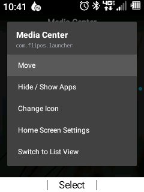
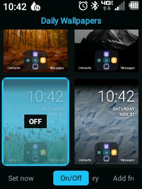
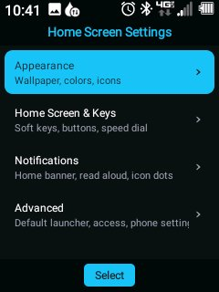

# Flip Launcher - full feature list

Everything Flip Launcher does, key by key. For the short version, see the
[README](README.md).

## Kyocera-specific features

The upstream launcher is a good KaiOS-style launcher, but it wasn't designed
for Kyocera phones and didn't support all of the Home screen shortcuts these
phones rely on - speed dial among them. Replacing Kyocera's own Home also
switches off several things Kyocera Home was quietly doing. This fork puts
them back:

- **Speed dial.** Hold a digit on Home to dial that speed-dial number (hold 1
  for voicemail). It reads the phone's own speed-dial list where it can; on
  the E4610, where that list can't be read, it uses the launcher's own slots
  under **Settings → Home Screen & Keys → Speed Dial**.
- **Hold `#` for vibrate**, like Kyocera Home: it switches the phone to
  Vibrate only, and holding it again puts back the ring mode you had before.
- **Call key** opens the call log of your default phone app - the stock
  dialer or a replacement.
- **Mic / Assistant key** works (it sends a different keycode depending on the
  model and what has focus) and opens the voice assistant by default.
- **Outer buttons** - SOS, outer END, outer Speaker and PTT. Their system
  setting only works under Kyocera Home, so the launcher lets you assign each
  one an app. A press opens it only while Home is showing, the screen is on and
  the phone is unlocked, so nothing happens in a pocket.
- **Kyocera's menus** - **Media Center**, **Tools** and **Quick Settings** -
  are in the app list, and can be pinned to a key like any other app. Quick
  Settings opens the phone's own panel (Wi-Fi, Bluetooth, Airplane mode,
  Hotspot and the rest all work).
- **Notifications on the E4810 / E4811.** Notification Access is blocked on
  these models, so the launcher uses Accessibility instead to show new
  notifications on Home, put dots on app icons, and read messages aloud.
- **Missed calls on Home.** On the E4810 / E4811 the phone never reports a
  missed call to other apps, so the launcher watches the call itself and puts
  "Missed call" with the caller's name on the Home banner.
- **The phone's own settings lead to the launcher's.** Opening the phone's
  wallpaper, shortcut-key or notification-sound settings brings up the
  launcher's version on top (Back returns to the phone's screen).
- **Keys behave consistently.** Every screen uses the same soft-key layout,
  actions fire when a key is released (so a press never spills into the next
  screen), and the phone's own soft-key label bar is hidden in favor of the
  launcher's.
- **Unknown buttons announce themselves.** Pressing a key the launcher doesn't
  recognize shows its keycode, so a new phone's buttons can be learned without
  a computer.

## Features

### Home

- A large clock and date, following the phone's 12/24-hour setting.
- The newest important notification as a banner underneath - messages, missed
  calls and calendar events by default - with the app's icon. A long message
  scrolls. It clears once you've opened that app and left it.
- **Left / Right soft keys** open an app each (Contacts and Messages by
  default). **Center / OK** opens the app list; **hold OK** to open the newest
  notification (or the Notices list when there's none).
- Each **navigation key** opens an app, shown as icons around the center key.
  Out of the box: Up = Calculator, Down = Notepad, Left = Calendar,
  Right = Quick Settings.
- Type a number to open the dialer with it - even typed quickly, every digit
  arrives. Hold a digit for speed dial; hold `#` for vibrate.
- **Call** opens the call log; **Back / Clear** opens the app list (hold it for
  Home Screen Settings); **Camera**, **Mic** and the outer buttons open their
  assigned apps. Out of the box: SOS = Weather, PTT = Flashlight,
  outer END = Timer, outer Speaker = Alarm clock (whichever the phone has).
- Hold any assignable key for 5 seconds to pick its app on the spot.

### App list

<p>
  
</p>

- Grid view (3x3 pages, number keys 1-9 launch the matching icon) or list
  view. It always opens on the first page's center icon.
- Default order: Contacts, Notices, Messaging, Gallery, Media Center, Notepad,
  Quick Settings, Settings, Tools (whichever the phone has), then everything
  else A-Z.
- Dots on the icons of apps with unread notifications.
- **Options** on any app: **Move**, **Hide / Show Apps**, **Change Icon**
  (from the launcher's own icons, or back to the original),
  **Home Screen Settings**, **Switch to List / Grid View**.
- The **Settings** entry asks whether you want **Phone Settings** or **Home
  Screen Settings**, with a **Don't ask again** option.

### Wallpapers

<p>
  
</p>

- **56 built-in wallpapers**, sized for the screen.
- **A new wallpaper every day.** The wallpaper screen (**Daily Wallpapers**)
  is the rotation: **OK** turns the highlighted one on or off (off ones are
  dimmed with OFF). The wallpaper moves to the next one that's on each day;
  leave just one on to keep it. **Left soft key** sets the highlighted one now.
- Each tile shows the wallpaper with your actual Home screen on top - clock,
  soft keys, shortcut icons and the dimming.
- **Add from gallery** (right soft key): pick a photo, then move (navigation
  keys), zoom (`#` / `*`) and rotate (`1` / `3`) it with Home drawn on top;
  **0** hides Home to see the photo alone, **5** resets. OK sets it and adds it
  to the rotation, mixed in among the built-in ones. Added photos can be
  removed again from the same key.
- The wallpaper is dimmed automatically according to how bright it is, so
  text and icons stay readable.

### Notices

A notification list sized for a small screen, standing in for the system
shade: icon, title, text and time for each one. **Left** dismisses the focused
notice, **Center** opens it, and **Options → Dismiss All** clears them all.
Needs Notification Access, so it works on the E4610; on the E4810 / E4811 it
opens the phone's own notification screen instead.

### Read Aloud

New messages and missed calls shown on Home can be read aloud ("Message from
… ", "Missed call from …") - never, always, or only when a Bluetooth headset
is connected - with a choice of voice and speed. Pressing any button, or a
headset's play/pause button, stops the reading; the button still does its
normal job. Volume keys only change the volume.

### Settings

<p>
  
</p>

A short list where each row opens its own screen:

- **Appearance** - wallpapers (the daily rotation above), accent color,
  light/dark theme, **App Icons** (a one-time switch of every matching app to
  the launcher's own icons, each still changeable later, or back to every app's
  own icon), icon size
- **Home Screen & Keys** - soft keys and navigation keys, Back hold, Menu;
  other buttons (Camera, Mic, SOS, outer END, outer Speaker, PTT); speed dial
- **Notifications** - which kinds show on the Home banner (missed calls,
  messages, events and reminders, other), hide message text, Read Aloud
  (when, voice, speed), icon dots
- **Advanced** - set as default launcher, Accessibility, Notification Access,
  Call Log Access, the Settings question, Phone Settings, Check for Updates

Text too long for the screen (a soft-key label, the highlighted row's
description) scrolls sideways instead of being cut off.

### Updates

About once a week the launcher checks GitHub for a newer release and offers
to install it. **Settings → Advanced → Check for Updates** checks right away.

### Look

- Built for 240x320 portrait screens and a keypad - no touch needed.
- The launcher's own icon set: a flat, colored symbol on a dark tile, applied
  in one step under **Appearance → App Icons**.
- Every icon is a squircle; the focused icon gets a ring in its own color.
- No animations - every screen change is instant.

### Key map

| Key | Home | Other screens |
|---|---|---|
| Left soft key | Assignable app (Contacts) | Screen's main action |
| Center / OK | App list (hold: newest notification) | Select |
| Right soft key | Assignable app (Messages) | Options |
| Menu | App list (hold: assignable app) | Options |
| Back / Clear | App list (hold: Home Screen Settings, or an assigned app) | Back |
| Call | Default phone app's call log | Call the focused entry (Recent Calls) |
| 0-9, `*` | Dialer, prefilled; hold 2-9 / 0 for speed dial, 1 for voicemail | 1-9 launch apps on the grid page |
| `#` | Dialer, prefilled; hold: Vibrate only / back to ring | - |
| Navigation keys | Assignable app per direction | Move focus |
| Camera / Mic | Assignable app (camera / voice assistant) | - |
| SOS / outer END / outer Speaker / PTT | Assigned app, only while Home is showing, the screen is on and the phone is unlocked | Left to the phone |

## Known limits

- **E4810 / E4811:** Notification Access appears to turn on but never works
  (a platform restriction); turn on Accessibility for the Home banner, icon
  dots, missed calls and Read Aloud.
- **E4810 / E4811:** the phone only tells other apps about notifications that
  make a sound or vibrate. A messaging app that updates its notification
  silently for a second message won't show it on Home.
- **Outer buttons** report only the press, not how long they're held, so they
  have no long-press action.
- Kyocera's internal screen names (call log, menus, settings pages) were
  captured on the E4610 and E4810 / E4811; if one differs on another model,
  the launcher falls back or shows a message instead of crashing.
- After updating, turn Flip Launcher's Accessibility switch **off and on**
  once so new abilities take effect.

## Installing

These phones have no Play Store, so the APK is sideloaded:

- **ADB:** `adb install -r app/build/outputs/apk/debug/app-debug.apk`, or
- **USB copy / email:** put the APK on the phone, open it from the Files app,
  and allow installs from that source when asked.

On first start Home asks, one at a time:

1. To become the **default Home app** - pick **Flip Launcher**.
2. To turn on **Accessibility** - needed on the E4810 / E4811 for
   notifications, missed calls and Read Aloud.
3. For **Call Log** access - so missed calls show who called, and declined
   calls are told apart.
4. For **Contacts** access - so missed calls show the contact's name.

Everything is also under **Settings → Advanced**, including **Notification
Access** for Notices and the Home banner on phones where it works (the
E4610). If Call Log access was denied before, the phone opens its app info:
**Permissions → Call logs**.

## Building

```bash
./gradlew :app:assembleDebug
```

The debug APK lands in `app/build/outputs/apk/debug/`.

- Any JDK from 17 to 26 runs the build (Android Studio's bundled one is fine).
- An Android SDK with `platforms;android-36` and `build-tools;36.0.0`, found
  through `local.properties` (`sdk.dir=...`) or `ANDROID_HOME`.
- The phone needs Android 5.0 (API 21) or newer.

See [CONTRIBUTING.md](CONTRIBUTING.md) for a from-scratch setup.

## Permissions

- **Notification Access** (`BIND_NOTIFICATION_LISTENER_SERVICE`) - Notices,
  the Home banner and icon dots, where it works (the E4610).
- **Accessibility service** - notifications and missed calls on the
  E4810 / E4811, stopping Read Aloud on any button, and opening the launcher's
  screens over the matching phone settings.
- **Call log** (`READ_CALL_LOG`) - Recent Calls, and naming missed calls.
- **Contacts** (`READ_CONTACTS`) - the caller's name on missed calls, and
  picking a contact for a speed-dial slot.
- `CALL_PHONE` - speed dial and voicemail place the call directly.
- `SET_WALLPAPER` - setting the wallpaper and the daily change.
- `INTERNET`, `ACCESS_NETWORK_STATE` - the weekly update check against
  GitHub Releases; `REQUEST_INSTALL_PACKAGES` - installing the update.

App enumeration uses a `<queries>` declaration rather than
`QUERY_ALL_PACKAGES`. Changing between ring and vibrate needs no permission.

## Screenshots

Screenshots are 240x320 captures from the phone (`adb exec-out screencap -p > file.png`)
in `reference/`: `home.png`, `apps.png`, `options.png`, `wallpapers.png` and
`settings.png`.
