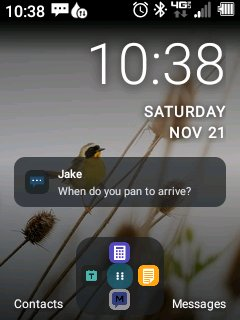
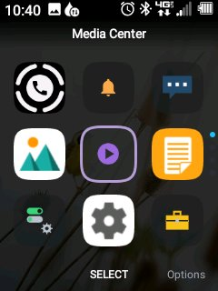
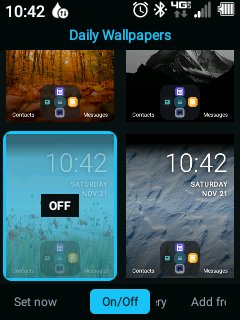

# Flip Launcher

### Your Kyocera flip phone, the way it should feel.

A fast, keypad-first Home screen for the Kyocera DuraXV Extreme **E4810 / E4811**
and **E4610**. Clean, quick and made for buttons, not a touchscreen. It does
everything Kyocera's own Home does, and a lot it never did.

<!-- TODO screenshots: retake on the phone (240x320) - see FEATURES.md → Screenshots. -->

  
  
  

## Why you'll like it

**Every button does something.** The soft keys, all four navigation keys, the
Camera and Mic keys, and even the outer SOS, END, Speaker and PTT buttons can
each open the app you choose. Out of the box they're already useful:
calculator, calendar, notepad, flashlight, timer, alarm, weather. Hold a digit
for speed dial, and hold `#` to flip between ring and vibrate, just like
before.

**Never miss a message.** New texts, missed calls and calendar reminders show
right on Home, with the app's icon and the caller's name. Plug in a Bluetooth
headset and the launcher can read new messages to you. One press of any button
hushes it.

**A fresh look every morning.** Fifty-six hand-picked wallpapers rotate
daily. Turn off the ones you don't like, keep just one if you'd rather, or add
your own photos: move, zoom and turn them with your actual Home screen drawn on
top, so you see exactly how it'll look before you set it.

**Feels like it was made for the phone.** Every screen is instant, with no
animations and no lag. Everything works from the keypad, the same keys do the
same things everywhere, and text that doesn't fit scrolls instead of being cut
off.

**Works with your phone, not against it.** Kyocera's Quick Settings, Media
Center and Tools menus are right there in the app list. Open the phone's
wallpaper or shortcut-key settings and the launcher's own version pops up.
The Call key opens the call log of whatever phone app you use, including
[BusyCall](https://github.com/Ben-Showalter/BusyCall).

**Your apps, your way.** Arrange the app grid, hide what you never use, and
give every app a matching icon from the launcher's own set in one step. Or keep
the originals.

**Keeps itself up to date.** Once a week it checks for a new version and offers
to install it.

## Get it in two minutes

1. Download the latest APK from
   [Releases](https://github.com/Ben-Showalter/flip-launcher/releases).
2. Put it on the phone (USB, email, or `adb install`) and open it from the
   Files app.
3. Say yes to the four questions it asks on first start: make it your **Home
   app**, turn on **Accessibility**, and allow **Call log** and **Contacts**.

That's it. Everything else is under **Settings** on the phone, any time.

## Good to know

- On the **E4810 / E4811**, keep Flip Launcher's **Accessibility** switch on:
  those phones block the usual notification access, so this is how Home sees
  your messages and missed calls.
- After an update, switch Accessibility **off and on** once so new features
  take effect.

## More

- **[Full feature list, key map and permissions](FEATURES.md)**
- [Building it yourself](FEATURES.md#building) · [Contributing](CONTRIBUTING.md)
- Built to the house rules in
  [Flip-DumbPhoneGuide](https://github.com/Ben-Showalter/Flip-DumbPhoneGuide/blob/main/AGENTS.md),
  a guide to writing apps for keypad flip phones.

## Credits

- A fork of
  [juliancruzsanchez/flip-launcher](https://github.com/juliancruzsanchez/flip-launcher),
  by way of AmberIsCoding's rework.
- Icons use glyphs from
  [Material Design Icons](https://pictogrammers.com/library/mdi/) by
  Pictogrammers (Apache License 2.0).
- Wallpapers: photos from [Unsplash](https://unsplash.com) and the author's own.
  <!-- TODO: decide how to credit the Unsplash photographers (the Unsplash
  License doesn't require it, but it's appreciated). -->
